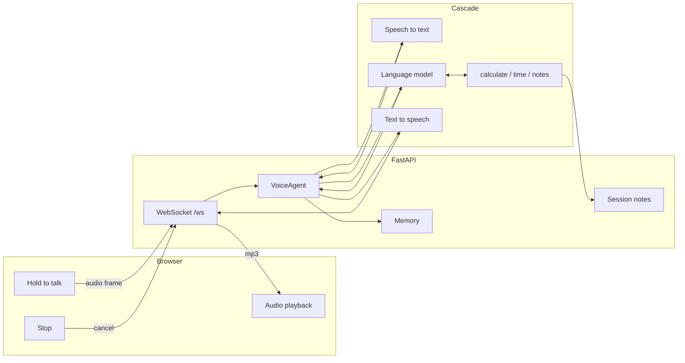
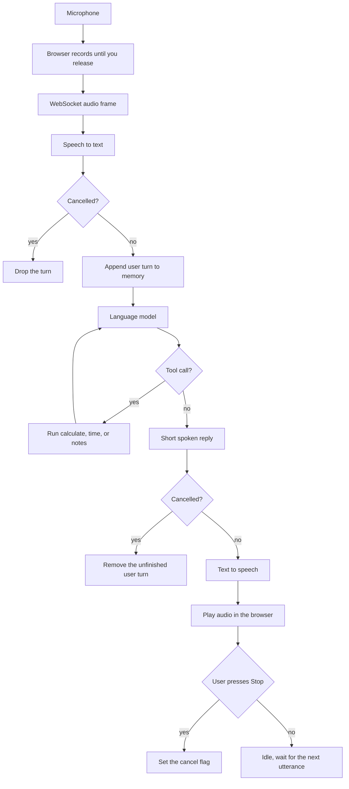

# Voice Agent from Scratch

A small cascade voice agent: microphone audio becomes text, a language model writes a short reply (with a few tools), and that reply is spoken back. You can cut the agent off mid-answer.

Offline by default (`PROVIDER=mock`). Set `PROVIDER=openai` and `OPENAI_API_KEY` when you want real speech recognition and speech synthesis.

## Run

```bash
python -m venv .venv
.venv\Scripts\activate
pip install -r requirements.txt
uvicorn app.server:app --reload
```

Open http://127.0.0.1:8000 . Hold **Hold to talk**, then release. Press **Stop** while audio is playing to barge in.

```bash
pytest
```

## Architecture

One browser tab holds one WebSocket. That socket owns one `VoiceAgent`: its own memory, its own notes, and a cancel flag. Speech recognition, the language model, and speech synthesis are stateless and shared.



## How a turn works



Each box is one module:

| Step | Module | Job |
| --- | --- | --- |
| Capture and playback | `static/index.html` | Records one utterance, plays MP3, sends `cancel` on barge-in |
| Session | `app/server.py` | One agent per WebSocket |
| Turn | `app/agent.py` | Orders ASR, memory, model, TTS, and checks cancellation |
| Memory | `app/memory.py` | Keeps the recent user and assistant turns |
| Tools | `app/tools.py` | Arithmetic, UTC time, session notes |
| Models | `app/providers.py` | Mock stack, or OpenAI transcription, chat, and speech |
